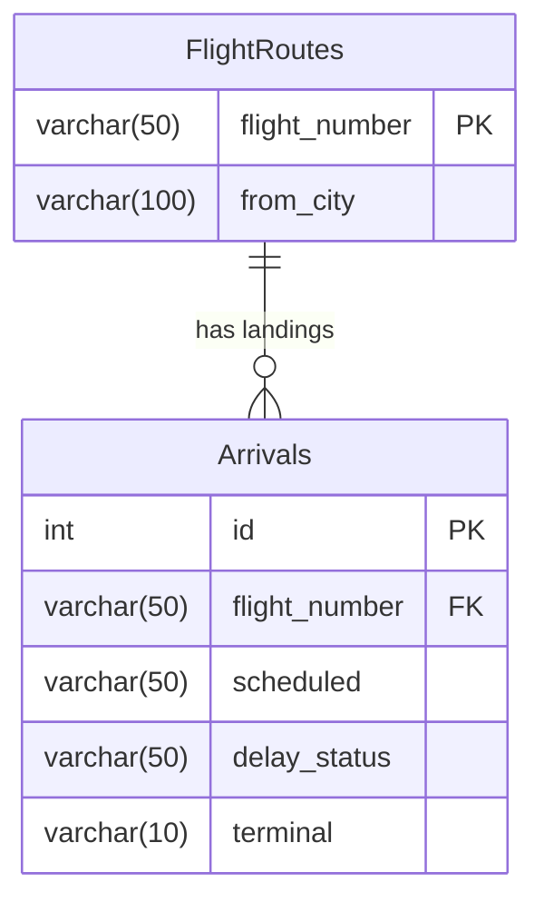

# Flight Arrivals Management System (`JDBC_FlightManager`)

**Course:** Software Engineering Methods (Academic Year 2026–2027)  
**Institution:** Braude College of Engineering | Department of Software Engineering  
**Database Engine:** MySQL 8.0+ | **Language:** Java 25 LTS (JDBC)

---

## 1. Project Description
This project implements the Data Access Layer (DAL) of an airport flight arrivals management system in Java using JDBC and a local MySQL database (`FlightDB`). Raw landing data from `arrived_flights.csv` (299 records) was imported into a flat table (`rawflights`) and normalized into Third Normal Form (3NF) as two related tables, `FlightRoutes` and `Arrivals`, using a local AI assistant (Continue with Qwen2.5-Coder-7B-Instruct in LM Studio).

The project includes:
- `FlightManagerBase` – connects to `FlightDB` and prints the joined arrivals board (`INNER JOIN`).
- `SimpleFlightUpdater` – updates the delay status of flight `LX354`. The original version used a `Statement` with string concatenation and was exploited with a live SQL Injection attack; it was then refactored into a secure `PreparedStatement`.
- `AdvancedFlightDispatcher` – updates several arrivals at once using a batched `PreparedStatement` (`addBatch` / `executeBatch`).
- `FlightViewer` – displays the arrivals of a selected terminal, sorted by scheduled time, using a parameterized `PreparedStatement`.

All JDBC resources (`Connection`, `Statement` / `PreparedStatement`, `ResultSet`) are managed with `try-with-resources`.

---

## 2. Engineering Team Details (Single-Workstation Driver–Navigator)

| Role | Full Name | Student ID | Braude Academic Email |
| :--- | :--- | :--- | :--- |
| **Student A** | `leen abu salah`| `212920672` | `leen.abusalah@e.braude.ac.il` |
| **Student B** | `liron skverchak` | `207432642` | `liron.skverchak@e.braude.ac.il` |

* **Group Number:** `G[XX]`
* **GitHub Repository URL:** `https://github.com/Lironskv/JDBC_FlightManager`

---

## 3. Technology Stack
* **Runtime & JDK:** BellSoft Liberica Full JDK 25 LTS
* **Database Server:** MySQL Server 8.0+ (`FlightDB` schema)
* **JDBC Driver:** MySQL Connector/J 9.5.0 (`mysql-connector-j-9.5.0.jar`)
* **IDE & Database Tooling:** IntelliJ IDEA Ultimate (Built-in Database Console & SQL Generator)
* **Local AI Assistant:** LM Studio (`Qwen2.5-Coder-7B-Instruct`) integrated via the Continue plugin
* **Version Control:** Git & GitHub

---

## 4. Database Normalization (3NF) & Functional Dependencies ($F$)

### 4.1 Functional Dependencies ($F$) in `rawflights`
The flat table `rawflights(scheduled, flight, fromC, delay, terminal)` represents landing events. The relevant functional dependencies are:
- $\text{flight} \rightarrow \text{fromC}$ – a flight number uniquely determines its departure city.
- $\{\text{flight}, \text{scheduled}\} \rightarrow \{\text{delay}, \text{terminal}\}$ – a specific landing event (a flight at a scheduled time) determines its delay status and arrival terminal.

Because the same flight can land on different dates and schedules, `flight` alone is not a candidate key (superkey) of the landing-event table.

### 4.2 Why `rawflights` Violated 3NF
`fromC` is a non-key attribute that depends on `flight`, which is not a superkey of `rawflights`. This violates 3NF and causes the departure city to be stored again in every landing row of the same flight (redundancy). As a result, the table suffers from three anomalies:
- **Update anomaly:** changing a flight's departure city requires updating every landing row of that flight; missing one row creates inconsistent data.
- **Insertion anomaly:** a new flight route cannot be recorded before at least one landing of that flight exists.
- **Deletion anomaly:** deleting the landing history of a flight also deletes the only record of its departure city.

Decomposing the table stores each flight number and its departure city exactly once in `FlightRoutes`, and links every landing to it through a Foreign Key, which removes all three anomalies.

### 4.3 Decomposed 3NF Relational Schema
**`FlightRoutes`** (parent table)
- `flight_number` VARCHAR(50) – **Primary Key**
- `from_city` VARCHAR(100) NOT NULL

**`Arrivals`** (child table)
- `id` INT AUTO_INCREMENT – **Primary Key**
- `flight_number` VARCHAR(50) NOT NULL – **Foreign Key** → `FlightRoutes(flight_number)` `ON DELETE CASCADE`
- `scheduled` VARCHAR(50)
- `delay_status` VARCHAR(50)
- `terminal` VARCHAR(10)

---

## 5. Independent AI Prompt (Part 4 – `FlightViewer.java`)

```text
Write a Java class FlightViewer with a main method.
Use Scanner to ask for the MySQL root password and connect with DriverManager to URL "jdbc:mysql://localhost:3306/FlightDB?allowLoadLocalInfile=true&allowPublicKeyRetrieval=true&serverTimezone=Asia/Jerusalem&useSSL=false", user "root".
Ask for a terminal number (valid: 2, 3, 4, 5).
Use try-with-resources and a PreparedStatement with '?':
SELECT a.scheduled, a.flight_number, r.from_city, a.delay_status, a.terminal FROM Arrivals a INNER JOIN FlightRoutes r ON a.flight_number = r.flight_number WHERE a.terminal = ? ORDER BY a.scheduled ASC
Bind it with pstmt.setString(1, terminal) because terminal is VARCHAR(10). Print the results in a formatted table.
```

---

## 6. Entity Relationship Diagram (ERD)



---

## 7. Security Audit Summary (Part 5 – SQL Injection Mitigation)
* **Attack Payload Tested:** `Landed' #`
* **Vulnerability Analysis (`Statement`):** The original `SimpleFlightUpdater` built the SQL command by concatenating user input into the query string, so the input became part of the SQL syntax. The payload produced `UPDATE Arrivals SET delay_status = 'Landed' #' WHERE flight_number = 'LX354'`. The single quote (`'`) closed the string literal early, and `#` started a MySQL comment, so the database ignored the rest of the line, including the `WHERE` clause. The command ran without any condition and overwrote the status of all 299 rows.
* **Remediation (`PreparedStatement`):** The class was refactored to use a parameterized query (`UPDATE Arrivals SET delay_status = ? WHERE flight_number = 'LX354'`). The query structure is sent and compiled before the input is bound, and the value set with `setString` is always treated as data (a literal), never as SQL code. Therefore the quote and the `#` are stored as ordinary characters and cannot change the structure of the command. Re-running the same payload updated only 1 row (`LX354`), which stored the status literally as `Landed' #`, while the other 298 rows were not affected.

---

## 8. License
Distributed under the **Braude College Academic License** (Software Engineering Methods, 2026–2027).
